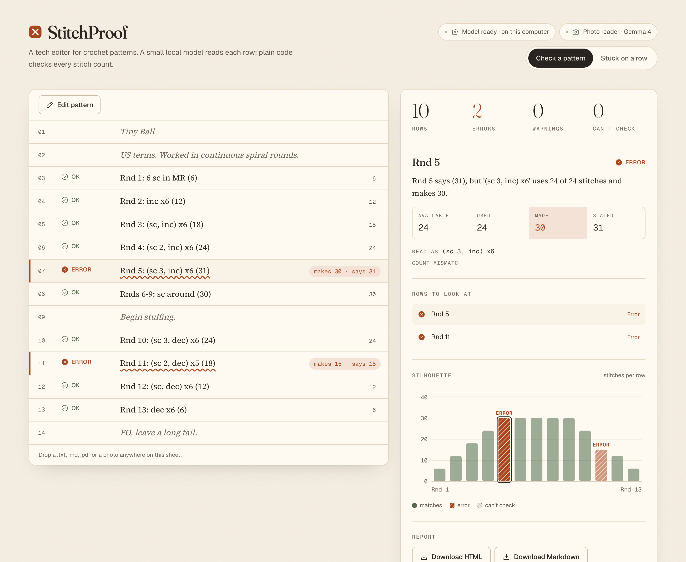
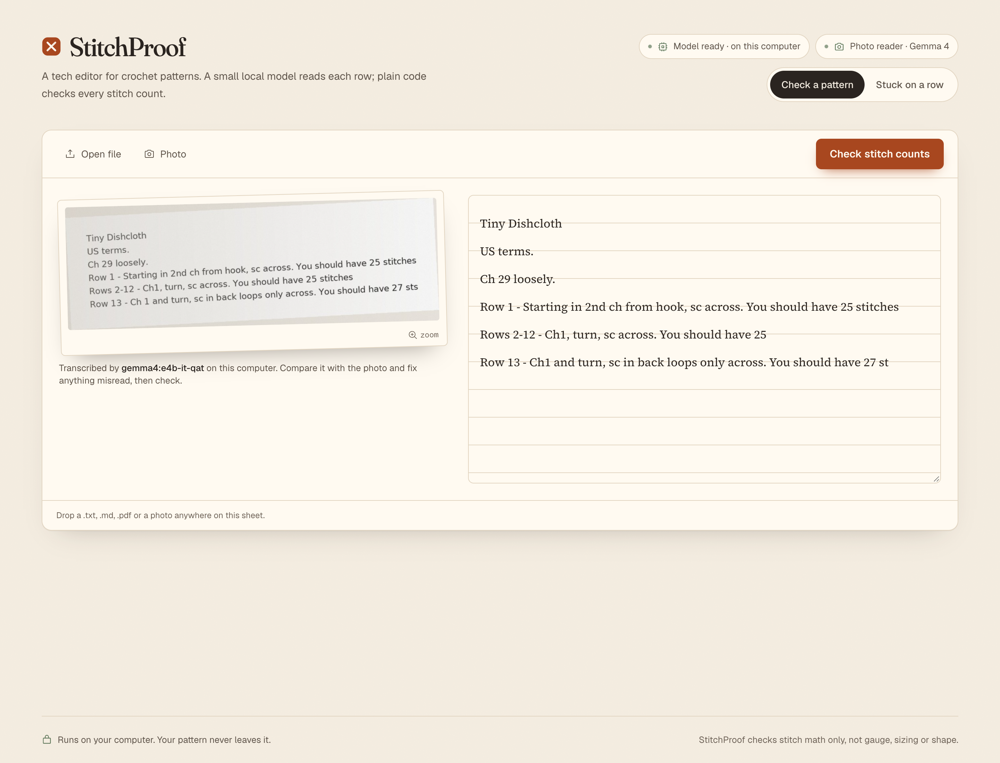
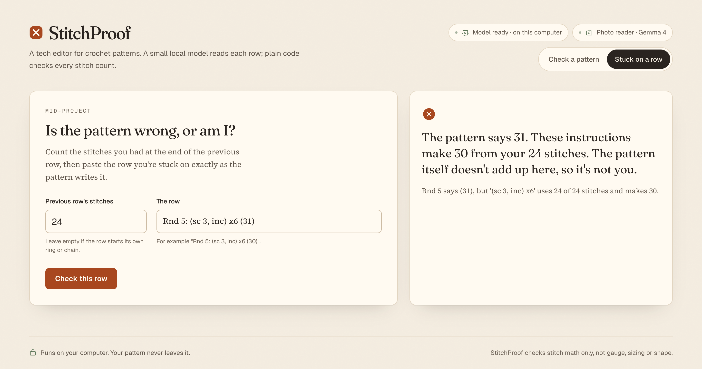
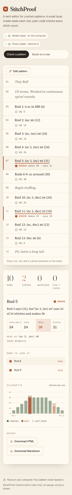
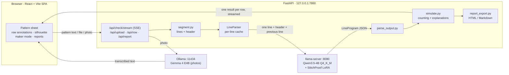
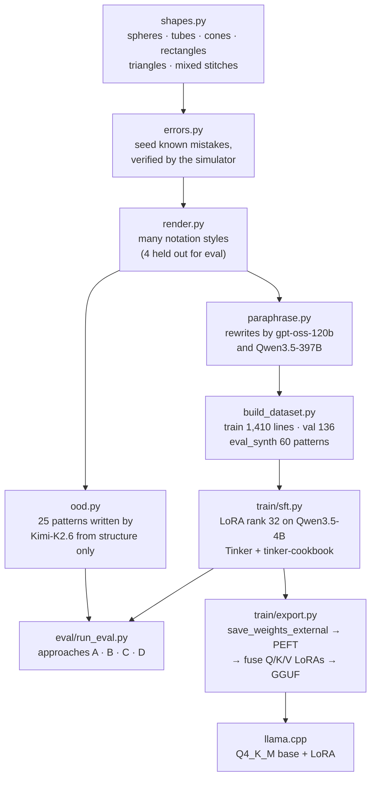

<div align="center">

# StitchProof

**A local tech editor for crochet patterns.**
A small fine-tuned model reads every row. Plain code checks every stitch count. Nothing leaves your computer.

[](https://github.com/HeetRanpura/stitchproof/actions/workflows/ci.yml)




[Demo video](docs/demo/stitchproof_demo.mp4) · [Results](#results) · [How it works](#how-it-works) · [Architecture](#architecture) · [Run it](#run-it-locally)

</div>

---

## Round 5 says 31. You count 30.

You've unravelled it twice. Is the pattern wrong, or are you?

Crochet designers sell their patterns as PDFs on Etsy and Ravelry. Before publishing, many pay a human tech editor to check every single stitch count, because one wrong number in round 5 means hundreds of makers tearing out an evening's work. Errata are a fact of life.

So why not ask an AI? We tried. Given 60 test patterns and asked directly to find the rows whose counts are wrong, the open-weight Qwen3.5-4B caught **44.4% (20/45)** of the mistakes. Chatbots are famously bad at crochet. They "count" stitches they never counted.

**StitchProof never asks a model to count.** The model only *translates* each row of notation into a precise stitch program. A deterministic simulator does all the arithmetic. With the fine-tuned translator, StitchProof caught **95.6% (43/45)** of the same mistakes. Every flag comes with its math:

> **Rnd 5 says (31), but '(sc 3, inc) x6' uses 24 of 24 stitches and makes 30.**

And because the model is small and the counting is plain code, the whole thing runs on a laptop with Wi-Fi off.

---

## Contents

- [What it does](#what-it-does)
- [How it works](#how-it-works)
- [Architecture](#architecture)
- [Tech stack](#tech-stack)
- [Results](#results)
- [Run it locally](#run-it-locally)
- [Online demo (Vercel)](#online-demo-vercel)
- [Reproduce the data, training and evaluation](#reproduce-the-data-training-and-evaluation)
- [Project structure](#project-structure)
- [Testing](#testing)
- [Design principles](#design-principles)
- [Limitations and what's next](#limitations-and-whats-next)
- [Credits and license](#credits-and-license)

---

## What it does

| | |
| --- | --- |
| **Check a pattern** (designers) | Paste a draft, open a `.txt` / `.md` / `.pdf`, or drop a photo. Each row is annotated in place as it's read, like a spellchecker: OK, ERROR, WARNING or CAN'T CHECK, always as an icon *and* a word. Select a row to see available / used / made / stated, the parsed program and the exact explanation. |
| **Silhouette chart** | Stitches made per row. For amigurumi it traces the outline of the piece, so a mistake shows up as a dent or a spike, hatched and labelled. |
| **Reports** | One-click HTML or Markdown report with the summary, flagged rows and the chart, ready to send to a tester or keep with the draft. |
| **Stuck on a row** (makers) | Enter the stitches you had and paste the row: *"The pattern says 31. These instructions make 30 from your 24 stitches. The pattern itself doesn't add up here, so it's not you."* |
| **Photos of printed patterns** | A local **Gemma 4** model transcribes the photo; the app shows the photo beside the editable transcription so you can fix any misread before checking. |
| **Private by design** | The server binds to `127.0.0.1`, fonts and icons are bundled, there's no telemetry, and patterns are never sent anywhere. |
| **Light and dark** | A toggle that follows your system until you pick one. |

| Photo review (Gemma 4) | Stuck on a row | On a phone |
| --- | --- | --- |
|  |  |  |

The business idea: makers use it free (that's distribution); designers would pay per pattern check or a small monthly fee, the stitch-math part of what a human tech editor does. That's a hypothesis, not a claim.

---

## How it works

The key design choice is a strict split between **reading** and **counting**.

```
"Rnd 5: (sc 3, inc) x6 (31)"
        │
        ▼  fine-tuned Qwen3.5-4B (LoRA): transcribes notation, never counts
{"kind":"round","label":"Rnd 5",
 "ops":[{"t":"repeat","times":6,"body":[{"t":"work","stitch":"sc","n":3},
                                        {"t":"into_one","stitch":"sc","k":2}]}],
 "stated_count":31}
        │
        ▼  simulator: plain Python, row by row
available 24 · used 24 · made 30 · stated 31  →  ERROR (COUNT_MISMATCH)
        │
        ▼  deterministic explanation (a template, never generated)
"Rnd 5 says (31), but '(sc 3, inc) x6' uses 24 of 24 stitches and makes 30."
```

1. **Segment.** The pattern is split into lines. Each line is parsed with a short header (title, US terms, rounds or rows) and the previous line for context.
2. **Translate.** The model turns one line into one `LineProgram` JSON object: work / increase / decrease / skip / "to end" / turning chain / repeat, plus the label, row ranges and the stated count, copied exactly as written even when it's wrong. Notes ("Stuff firmly") become `note`; lace, multi-size, UK terms and the like become `unsupported` with a reason. ([schema](src/stitchproof/schema.py), [prompt](src/stitchproof/prompts.py))
3. **Parse robustly.** Fences, stray text, synonyms and missing fields are handled; anything unreadable becomes CAN'T CHECK, never a guess. ([parser](src/stitchproof/parse_output.py))
4. **Simulate.** The counting engine walks the rows in order: magic rings, foundation chains and skipped chains, turning chains that do or don't count, repeats that must divide "around", ranges like `Rnds 6-9`. It reports `COUNT_MISMATCH`, `OVERFLOW`, `LEFTOVER`, `REPEAT_REMAINDER`, `NO_STATED_COUNT` or `CANT_CHECK`. After a wrong row it re-syncs to the designer's stated count, so one mistake is reported once instead of cascading. ([simulator](src/stitchproof/simulate.py), [counting conventions](CONVENTIONS.md))
5. **Explain.** Every verdict is a fixed template filled with the numbers, so you can check the arithmetic yourself.

Because the model's only job is transcription, the improvement from fine-tuning is **measured by code**, not by opinion: we compare its programs against gold programs and let the simulator count.

---

## Architecture

### At runtime (everything on your machine)



- Results **stream** row by row over Server-Sent Events, so the sheet fills in as the model reads. This is exact because the simulator is sequential: a row's result depends only on the rows before it.
- Each parsed line is cached by a hash of (header, previous line, line), so re-checking an edited pattern only sends the changed lines.
- Photos are read into a temp file, transcribed and deleted; images are never stored.

### Building the model (training time, on Tinker)



- **No published patterns anywhere.** All training and eval text is generated by our own code, plus model rewrites of that text.
- **Errors are seeded into the gold programs, then rendered**, so text and labels can't drift apart. Every seeding is checked: the simulator must flag exactly the seeded rows.
- **Held-out notation:** four styles (`Round 3 -` labels, `rep from * N more times`, `you should have N`, `sc in each of the next N st`) and one shape (cones) never appear in training.
- **Export detail worth knowing:** Tinker trains Qwen3.5's linear-attention Q, K and V projections as separate LoRAs, but the model stores them fused. `export.py` rebuilds an exact fused LoRA for llama.cpp (stacked A matrices, block-diagonal B matrices, rescaled for llama.cpp's alpha/rank).

---

## Tech stack

| Layer | Tools |
| --- | --- |
| **Model** | [Qwen3.5-4B](https://huggingface.co/Qwen/Qwen3.5-4B) + LoRA (rank 32), thinking disabled |
| **Training** | [Tinker](https://thinkingmachines.ai/tinker/) and `tinker-cookbook` (supervised loop, renderers, weight export) |
| **Data** | Python generators; teacher rewrites by `openai/gpt-oss-120b` and `Qwen/Qwen3.5-397B-A17B`; OOD set by `moonshotai/Kimi-K2.6` (all on Tinker) |
| **Local inference** | [llama.cpp](https://github.com/ggml-org/llama.cpp) `llama-server` (Metal), Q4_K_M GGUF base + LoRA GGUF, built with llama.cpp's own converters |
| **Photo reader** | [Gemma 4](https://ollama.com/library/gemma4) `gemma4:e4b-it-qat` via [Ollama](https://ollama.com) |
| **Engine** | Python 3.11, Pydantic 2 (schema), a dependency-free simulator |
| **Server** | FastAPI + Uvicorn (Server-Sent Events), pypdf, Jinja2 and Matplotlib for reports |
| **Frontend** | React 19, TypeScript 5.9, Vite 8, Tailwind CSS 4, Motion, Phosphor icons, self-hosted fonts (Fraunces, Source Serif 4, Geist, Geist Mono) |
| **Fallback UI** | Gradio (`python -m stitchproof.app.ui`) |
| **Testing and CI** | pytest, Vitest, GitHub Actions (tests, typecheck, build, and a check that the committed UI build matches the source); headless Chrome via puppeteer-core for screenshots and the demo video |

---

## Results

Four approaches, the same eval sets, the same prompt and the same parser, at temperature 0:

| ID | Approach |
| --- | --- |
| A | Base Qwen3.5-4B, asked directly to find count errors in the whole pattern |
| B | gpt-oss-120b asked the same way (a much larger model, reference only, run on 15 patterns) |
| C | Base Qwen3.5-4B transcribing each line + the simulator |
| D | **Fine-tuned Qwen3.5-4B transcribing each line + the simulator (StitchProof)** |


| | A: base, direct | B: teacher, direct (ref.) | C: base + simulator | D: fine-tuned + simulator |
| --- | --- | --- | --- | --- |
| **eval_synth: errors caught** | 44.4% (20/45) | 54.5% (6/11) | 75.6% (34/45) | **95.6% (43/45)** |
| **eval_synth: false alarms** | 13.7% (78/571) | 38.3% (62/162) | 42.6% (243/571) | **22.2% (127/571)** |
| **OOD: errors caught** | 61.1% (11/18) | – | 100.0% (18/18) | **100.0% (18/18)** |
| **OOD: false alarms** | 11.2% (23/205) | – | 50.7% (104/205) | **8.3% (17/205)** |
| OOD: pattern-level accuracy | 32.0% (8/25) | – | 16.0% (4/25) | **80.0% (20/25)** |
| eval_synth: valid JSON | 86.7% (52/60) | 100.0% (15/15) | 78.0% (663/850) | **100.0% (850/850)** |
| eval_synth: count-equivalence | – | – | 12.0% (74/616) | **78.7% (485/616)** |
| eval_synth: stated-count faithfulness | – | – | 67.4% (415/616) | **100.0% (616/616)** |

- **eval_synth:** 60 patterns written only in the four held-out notation styles, a third of them cones.
- **OOD:** 25 patterns whose text was written by Kimi-K2.6, a third model family, from the structure alone.
- **Errors caught** = seeded error rows flagged ERROR / all seeded error rows. **False alarms** = clean rows flagged ERROR / all clean rows. Every rate is shown with its count.

**The one weak spot, measured honestly.** Almost all of D's false alarms on eval_synth come from a single held-out style, `*sc, inc; rep from * 4 more times`, which means 5 repeats; D transcribes it as 4. On those lines D raises false alarms on 97.5% (115/118) of clean rows. On lines in the other three held-out styles it parses 99.8% (466/467) exactly, with 2.7% (12/438) false alarms. We didn't retrain on it, because that would be tuning on the test set; it goes into the next version's training templates. Full tables, per-error-type results and C/D disagreements: [eval/results/summary.md](eval/results/summary.md).

**Training.** LoRA rank 32 on Qwen3.5-4B with Tinker, 1 epoch over 1,410 line examples from three sources: our code templates (60 patterns) and rewrites by gpt-oss-120b and Qwen3.5-397B (43 patterns). Validation loss went from 0.303 to 0.0028 ([loss curve](eval/results/loss_curve.json)). The whole build, covering data, baselines, training and evaluation, used **US$1.62** of Tinker credit ([costs](eval/results/costs.md)).

**Local model.** A Q4_K_M base built from the official Qwen weights plus the LoRA agrees with the Tinker-hosted model on **100.0% (50/50)** of validation lines ([export.md](eval/results/export.md)):

| Disk | RAM | Load time | Per line (M4 MacBook) |
| --- | --- | --- | --- |
| 2.93 GB | 3.18 GB | 2.5 s | 2.36 s mean |

**Photo reader (Gemma 4).** On 12 held-out patterns rendered as a clean scan and as a phone-style photo (slight rotation, uneven light, noise, JPEG) ([photo_reader.md](eval/results/photo_reader.md)):

| | Original text | Scan → Gemma | Photo → Gemma |
| --- | --- | --- | --- |
| Numbers kept | – | 98.9% (357/361) | 98.1% (354/361) |
| Errors caught, end to end | 100.0% (12/12) | 91.7% (11/12) | 100.0% (12/12) |
| False alarms, end to end | 23.2% (22/95) | 25.3% (24/95) | 22.1% (21/95) |
| Lines character-perfect | – | 50.3% (81/161) | 42.2% (68/161) |

Gemma keeps the numbers but tends to drop separators like " - ", which is why the app always puts the photo next to the editable transcription.

---

## Run it locally

**Requirements:** Python 3.11, [llama.cpp](https://github.com/ggml-org/llama.cpp) (`brew install llama.cpp`), about 3 GB of disk for the model. [Ollama](https://ollama.com) is optional, for photos.

```bash
uv venv --python 3.11 && uv pip install -e ".[app,dev]"
pytest -q
```

Build the local model once (needs a Tinker key in `.env`, downloads the official Qwen weights, converts, then deletes the large copy):

```bash
python -m stitchproof.train.export download
python -m stitchproof.train.export peft
python -m stitchproof.train.export gguf
```

Start the model and the app:

```bash
llama-server -m models/stitchproof-base-q4_k_m.gguf --lora models/stitchproof-lora-v1.gguf --port 8080 --host 127.0.0.1 --jinja -c 4096 -np 1
python -m stitchproof.app.server
```

Open **http://127.0.0.1:7860** and click *"Or try a sample pattern with two mistakes in it"*.

- **Photos (optional):** `ollama pull gemma4:e4b-it-qat`, with the Ollama app running.
- **Fully offline:** once the model files are on disk, turn Wi-Fi off and start the two commands above.
- **No model handy?** `STITCHPROOF_BACKEND=replay python -m stitchproof.app.server` replays gold answers for the synthetic example patterns.
- **Frontend development:** the UI is prebuilt in `src/stitchproof/app/web/`, so Node isn't needed to run it. To work on it: `npm --prefix frontend install && npm --prefix frontend run dev` (proxies `/api` to the server), then `npm --prefix frontend run build`.

---

### Online demo (Vercel)

The repo deploys to Vercel as one project with two services ([vercel.json](vercel.json)): **`frontend`** (the Vite app, served at `/`) and **`app`** (the FastAPI server, served at `/api/*`). Vercel can't run llama.cpp or Ollama, so the hosted app runs in **demo mode**. It replays the fine-tuned model's real, recorded answers for the sample pattern ([data/demo/recorded.jsonl](data/demo/recorded.jsonl), made with `python -m stitchproof.app.record_demo`) and labels itself as a demo. Other patterns come back as CAN'T CHECK with a pointer to installing StitchProof, and photo uploads are disabled. To check your own patterns, install it locally: that's the private, full version.

## Reproduce the data, training and evaluation

```bash
cp .env.example .env    # add TINKER_API_KEY
python -m stitchproof.generate.build_dataset --train-lines 1400 --val-lines 120     # template splits (fixed seed)
python -m stitchproof.generate.paraphrase                                          # rewrites by two teacher families
python -m stitchproof.generate.build_dataset --train-lines 1400 --val-lines 120 --paraphrased data/generated/paraphrased.jsonl
python -m stitchproof.generate.ood                                                 # out-of-generator eval set
python -m stitchproof.train.sft --dry-run                                          # token and cost estimate
python -m stitchproof.train.sft
python -m stitchproof.eval.run_eval --approach C --set synth                       # likewise A, B, D and --set ood
python -m stitchproof.eval.report                                                  # eval/results/summary.md + chart
python -m stitchproof.eval.equivalence --n 50                                      # local vs Tinker (llama-server running)
python -m stitchproof.eval.photo_eval --n 12                                       # Gemma photo reader (Ollama running)
```

Every script that calls Tinker prints a cost estimate first and stops above a budget limit. The dataset build is reproducible byte for byte from its fixed seed.

**Real drafts (private):** put a draft you have permission to use in `data/real/` (gitignored) and run `python -m stitchproof.eval.label_real data/real/<draft>.txt` in your own terminal. It shows each line's local parse, lets you accept or correct it, and saves gold labels for `run_eval --set real`, which stores no pattern text. It refuses to run in CI or without a terminal.

---

## Project structure

```
stitchproof/
├── CONVENTIONS.md            counting rules (one test each)
├── SPEC.md                   the build spec
├── src/stitchproof/
│   ├── schema.py             LineProgram: the model's only output format
│   ├── prompts.py            the one shared prompt (training, eval, app)
│   ├── segment.py            lines + per-line header
│   ├── parse_output.py       robust JSON extraction and validation
│   ├── simulate.py           counting engine, error codes, explanations, maker mode
│   ├── canonical.py          canonical programs for exact-match scoring
│   ├── tinker_io.py          Tinker sampling, caching, token accounting
│   ├── generate/             shapes, render, errors, paraphrase, ood, build_dataset
│   ├── train/                sft.py (LoRA on Tinker), export.py (PEFT, fused LoRA, GGUF)
│   ├── eval/                 run_eval, metrics, report, equivalence, photo_eval, label_real
│   └── app/                  server.py (FastAPI), local_model.py, inputs.py,
│                             photo_reader.py, report_export.py, ui.py (Gradio), web/ (built UI)
├── frontend/                 React + Vite + Tailwind source, tests, screenshot and video scripts
├── data/generated/           synthetic train / val / eval_synth (committed)
├── data/ood/                 out-of-generator eval set (committed)
├── data/real/                private drafts (gitignored)
├── eval/results/             every number in this README, with counts
├── docs/                     screenshots, demo video, example report, post draft
└── tests/                    pytest suite
```

---

## Testing

```bash
pytest -q                                    # 149 tests
npm --prefix frontend run typecheck && npm --prefix frontend test
```

- **Simulator golden tests:** the classic 6-start sphere, sc and dc rectangles (including "ch 3 counts as dc"), a triangle with end increases, and one test per error code and per counting convention.
- **Robustness:** the parser (fences, `<think>` blocks, synonyms, missing fields), segmentation, canonicalisation and PDF reading.
- **Data:** generators that never leak held-out styles, verified error seeding, reproducible builds.
- **App:** the FastAPI endpoints (streaming, uploads, photos with a mocked Ollama, reports), labelling-tool guards, and frontend helpers (SSE parsing, chart maths, status labels).
- **CI** runs all of it on every push, rebuilds the frontend and fails if the committed build is stale.

---

## Design principles

1. **Code decides counts.** The model transcribes; it never computes or "corrects" a number, and it copies wrong stated counts faithfully so the simulator can catch them.
2. **Every flag is verifiable.** Explanations are templates filled with the numbers, never generated text.
3. **Can't check is an answer.** Lace, multi-size patterns, UK terms, short rows and Tunisian crochet are marked CAN'T CHECK with a reason, never guessed.
4. **Private by default.** Patterns are processed only on your machine. Real drafts are never committed, and no published patterns are used for training.
5. **Honest evaluation.** The same prompt, eval sets and parser for every approach. Nothing is tuned on the eval sets, and every percentage is reported with its count, including the weak spot.

---

## Limitations and what's next

- Training data is synthetic, and no real designer drafts have been evaluated yet.
- Notation the model hasn't seen can trip it up; "rep from * N more times" is the measured example.
- v1 covers US terms, amigurumi rounds and flat rows with common stitches. Charts, lace and chain spaces, multi-size patterns, UK terms, short rows and Tunisian crochet are CAN'T CHECK.
- Counting conventions vary between designers; StitchProof follows [CONVENTIONS.md](CONVENTIONS.md).
- It checks stitch math only, not gauge, fit or how the finished piece looks.

**Next:** add the "more times" style (and others) to the training templates and evaluate on fresh held-out styles; label and test permitted real drafts; package the model for Ollama; the same translate → simulate → verify design should carry over to knitting.

---

## Credits and license

Built by Heet Ranpura for the DEV Hacktoberfest 2026 Open-Source AI Challenge.

Thanks to [Tinker](https://thinkingmachines.ai/tinker/) for fine-tuning, the Qwen team for Qwen3.5, Google DeepMind for Gemma 4, and the llama.cpp and Ollama projects for local inference.

Code: MIT ([LICENSE](LICENSE)). Model weights keep their own licenses (Qwen3.5-4B, Gemma 4); check each model card before redistributing.
