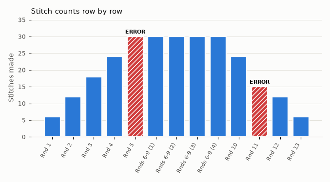

# StitchProof report: Tiny Ball (example)

Checked 2026-10-17 with llama.cpp (local, http://127.0.0.1:8080).

**10 rows checked, 2 errors.**

## Rows to look at

- **✖ ERROR** `Rnd 5: (sc 3, inc) x6 (31)`  
  Rnd 5 says (31), but '(sc 3, inc) x6' uses 24 of 24 stitches and makes 30.
- **✖ ERROR** `Rnd 11: (sc 2, dec) x5 (18)`  
  Rnd 11 says (18), but '(sc 2, dec) x5' uses 20 of 24 stitches and makes 15. The row is worked across or around, but 4 stitches are left unworked.

## All rows

| # | Row | Text | Parsed program | Available | Used | Made | Stated | Status | Explanation |
| --- | --- | --- | --- | --- | --- | --- | --- | --- | --- |
| 3 | Rnd 1 | Rnd 1: 6 sc in MR (6) | in a magic ring: sc 6 | 0 | 0 | 6 | 6 | ✔ OK | Rnd 1 says (6). 'sc 6' worked into the magic ring makes 6, so this matches. |
| 4 | Rnd 2 | Rnd 2: inc x6 (12) | inc x6 | 6 | 6 | 12 | 12 | ✔ OK | Rnd 2 says (12). 'inc x6' uses 6 of 6 stitches and makes 12, so this matches. |
| 5 | Rnd 3 | Rnd 3: (sc, inc) x6 (18) | (sc 1, inc) x6 | 12 | 12 | 18 | 18 | ✔ OK | Rnd 3 says (18). '(sc 1, inc) x6' uses 12 of 12 stitches and makes 18, so this matches. |
| 6 | Rnd 4 | Rnd 4: (sc 2, inc) x6 (24) | (sc 2, inc) x6 | 18 | 18 | 24 | 24 | ✔ OK | Rnd 4 says (24). '(sc 2, inc) x6' uses 18 of 18 stitches and makes 24, so this matches. |
| 7 | Rnd 5 | Rnd 5: (sc 3, inc) x6 (31) | (sc 3, inc) x6 | 24 | 24 | 30 | 31 | ✖ ERROR | Rnd 5 says (31), but '(sc 3, inc) x6' uses 24 of 24 stitches and makes 30. |
| 8 | Rnds 6-9 | Rnds 6-9: sc around (30) | sc in each remaining st | 30 | 30 | 30 | 30 | ✔ OK | Rnds 6-9 says (30). 'sc in each remaining st' uses 30 of 30 stitches and makes 30, so this matches. The same holds for each round 6 to 9. |
| 10 | Rnd 10 | Rnd 10: (sc 3, dec) x6 (24) | (sc 3, dec) x6 | 30 | 30 | 24 | 24 | ✔ OK | Rnd 10 says (24). '(sc 3, dec) x6' uses 30 of 30 stitches and makes 24, so this matches. |
| 11 | Rnd 11 | Rnd 11: (sc 2, dec) x5 (18) | (sc 2, dec) x5 | 24 | 20 | 15 | 18 | ✖ ERROR | Rnd 11 says (18), but '(sc 2, dec) x5' uses 20 of 24 stitches and makes 15. The row is worked across or around, but 4 stitches are left unworked. |
| 12 | Rnd 12 | Rnd 12: (sc, dec) x6 (12) | (sc 1, dec) x6 | 18 | 18 | 12 | 12 | ✔ OK | Rnd 12 says (12). '(sc 1, dec) x6' uses 18 of 18 stitches and makes 12, so this matches. (Checked from the 18 stitches stated for Rnd 11, since that row's instructions don't match it.) |
| 13 | Rnd 13 | Rnd 13: dec x6 (6) | dec x6 | 12 | 12 | 6 | 6 | ✔ OK | Rnd 13 says (6). 'dec x6' uses 12 of 12 stitches and makes 6, so this matches. |

_Runs on your computer. Your pattern never leaves it. StitchProof checks stitch math only, not gauge, sizing or shape._
