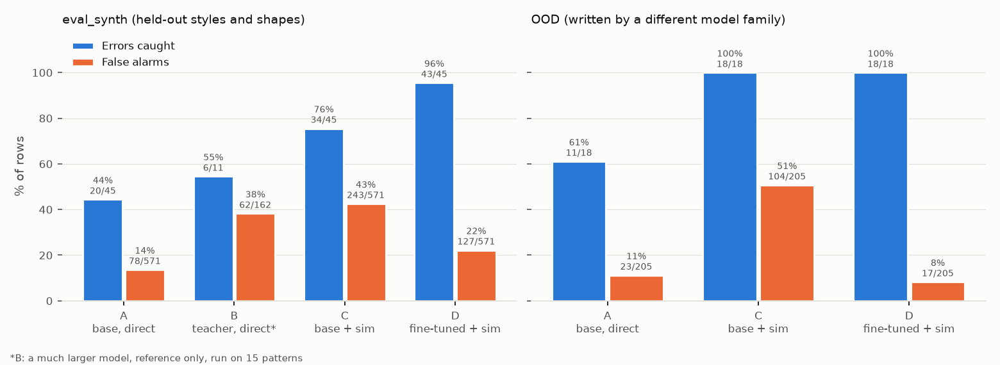

# StitchProof evaluation summary

Generated by `python -m stitchproof.eval.report` from the files in `eval/results/`. Every rate is shown with its count.
Errors caught = seeded error rows flagged ERROR / all seeded error rows. False alarms = clean rows flagged ERROR / all clean rows.
B uses a much larger teacher model and is a reference only.

## eval_synth (held-out styles and shapes)

| Metric | A: base, direct check | B: teacher, direct check (reference) | C: base + simulator | D: fine-tuned + simulator |
| --- | --- | --- | --- | --- |
| **Errors caught** | 44.4% (20/45) | 54.5% (6/11) | 75.6% (34/45) | 95.6% (43/45) |
| **False alarms** | 13.7% (78/571) | 38.3% (62/162) | 42.6% (243/571) | 22.2% (127/571) |
| Pattern-level accuracy | 15.0% (9/60) | 13.3% (2/15) | 15.0% (9/60) | 40.0% (24/60) |
| Valid JSON | 86.7% (52/60) | 100.0% (15/15) | 78.0% (663/850) | 100.0% (850/850) |
| Line parse exact match | n/a | n/a | 31.4% (267/850) | 84.6% (719/850) |
| Count-equivalence | n/a | n/a | 12.0% (74/616) | 78.7% (485/616) |
| Stated-count faithfulness | n/a | n/a | 67.4% (415/616) | 100.0% (616/616) |
| Missing count warned | n/a | n/a | 36.6% (15/41) | 100.0% (41/41) |
| Flags on non-row lines | 0 | 0 | 1 | 0 |
| Can't check (correct / wrong) | n/a | n/a | 0 / 1 | 0 / 0 |

### Errors caught by seeded error type

| Seeded error type | A | B | C | D |
| --- | --- | --- | --- | --- |
| NON_DIVISIBLE_AROUND | 33.3% (2/6) | 0.0% (0/1) | 100.0% (6/6) | 100.0% (6/6) |
| WRONG_FOUNDATION | 22.2% (2/9) | 66.7% (2/3) | 66.7% (6/9) | 100.0% (9/9) |
| WRONG_REPEAT_TIMES | 50.0% (3/6) | 100.0% (1/1) | 100.0% (6/6) | 66.7% (4/6) |
| WRONG_RUN_LENGTH | 50.0% (4/8) | 50.0% (1/2) | 87.5% (7/8) | 100.0% (8/8) |
| WRONG_STATED | 56.2% (9/16) | 50.0% (2/4) | 56.2% (9/16) | 100.0% (16/16) |

### By held-out notation style

Every eval_synth pattern uses all four notation styles that never appear in training. Lines are grouped so each line counts once.

| Lines written in this style | C: exact match | D: exact match | C: false alarms | D: false alarms |
| --- | --- | --- | --- | --- |
| rep from * N more times | 0.7% (1/134) | 3.0% (4/134) | 55.1% (65/118) | 97.5% (115/118) |
| other held-out styles only (dash labels, 'you should have N', 'each of the next N st') | 6.9% (32/467) | 99.8% (466/467) | 40.6% (178/438) | 2.7% (12/438) |
| no held-out style (notes, foundation chains, ...) | 94.0% (234/249) | 100.0% (249/249) | 0.0% (0/15) | 0.0% (0/15) |

### Where C and D disagree

436 lines where C and D give different statuses. First 5:

- `eval-0000`: `Round 2 - *sc inc; rep from * 4 more times. You should have 10 stitches`
  - truth **OK** · C **ERROR**: Round 2 says (10), but '(sc 1, inc) x5' worked into the magic ring makes 15.
  - D **OK**: Round 2 says (10). 'inc x5' uses 5 of 5 stitches and makes 10, so this matches.
- `eval-0000`: `Round 11 - *sc in the next st, dec* around. You should have 10 sts`
  - truth **OK** · C **ERROR**: Round 11 says (10), but '(sc 1, dec) x10' worked into the magic ring makes 20.
  - D **OK**: Round 11 says (10). '(sc 1, dec) around' uses 15 of 15 stitches and makes 10, so this matches. (Checked from the 15 stitches stated for Round 10, since that row's instructions don't match it.)
- `eval-0000`: `Round 12 - *dec* around. You should have 5 sts`
  - truth **OK** · C **ERROR**: Round 12 says (5), but '(sc 1, dec) x5' worked into the magic ring makes 10.
  - D **OK**: Round 12 says (5). 'dec around' uses 10 of 10 stitches and makes 5, so this matches.
- `eval-0001`: `Row 2 - CH 1, turn, SC in the next st, HDC in the next st, DC in each of the next 10 st, HDC in the next st, SC in the next st. You should have 14 sts`
  - truth **OK** · C **CAN'T CHECK**: StitchProof couldn't read this line, so it can't be checked.
  - D **OK**: Row 2 says (14). 'ch 1, sc 1, hdc 1, dc 10, hdc 1, sc 1' uses 14 of 14 stitches and makes 14, so this matches. (Checked from the 14 stitches stated for Row 1, since that row's instructions don't match it.)
- `eval-0001`: `Row 3 - CH 1, turn, SC across`
  - truth **WARNING** · C **CAN'T CHECK**: Can't check Row 3: the starting stitch count is unknown because an earlier line couldn't be read. Later rows are checked from its stated count of 14.
  - D **WARNING**: Row 3: 'ch 1, sc in each remaining st' uses 14 of 14 stitches and makes 14. The pattern doesn't state a count for this row.

Token usage: A: 27,353 prompt + 23,166 completion tokens, B: 7,743 prompt + 11,471 completion tokens, C: 570,260 prompt + 54,442 completion tokens, D: 571,525 prompt + 32,366 completion tokens.

## OOD (written by a different model family)

| Metric | A: base, direct check | C: base + simulator | D: fine-tuned + simulator |
| --- | --- | --- | --- |
| **Errors caught** | 61.1% (11/18) | 100.0% (18/18) | 100.0% (18/18) |
| **False alarms** | 11.2% (23/205) | 50.7% (104/205) | 8.3% (17/205) |
| Pattern-level accuracy | 32.0% (8/25) | 16.0% (4/25) | 80.0% (20/25) |
| Valid JSON | 88.0% (22/25) | 83.8% (275/328) | 100.0% (328/328) |
| Line parse exact match | n/a | 41.5% (136/328) | 81.1% (266/328) |
| Count-equivalence | n/a | 32.7% (73/223) | 91.0% (203/223) |
| Stated-count faithfulness | n/a | 74.9% (167/223) | 97.3% (217/223) |
| Missing count warned | n/a | 50.0% (6/12) | 50.0% (6/12) |
| Flags on non-row lines | 2 | 1 | 2 |
| Can't check (correct / wrong) | n/a | 0 / 0 | 0 / 0 |

### Errors caught by seeded error type

| Seeded error type | A | C | D |
| --- | --- | --- | --- |
| NON_DIVISIBLE_AROUND | 33.3% (1/3) | 100.0% (3/3) | 100.0% (3/3) |
| WRONG_FOUNDATION | 60.0% (3/5) | 100.0% (5/5) | 100.0% (5/5) |
| WRONG_REPEAT_TIMES | 50.0% (1/2) | 100.0% (2/2) | 100.0% (2/2) |
| WRONG_RUN_LENGTH | 75.0% (3/4) | 100.0% (4/4) | 100.0% (4/4) |
| WRONG_STATED | 75.0% (3/4) | 100.0% (4/4) | 100.0% (4/4) |

### Where C and D disagree

146 lines where C and D give different statuses. First 5:

- `ood-0001`: `Rows 2-7: Sc in each st across. (17)`
  - truth **OK** · C **ERROR**: Rows 2-7 (row 2 of the range) says (17), but 'sc 1' uses 1 of 17 stitches and makes 1. The row is worked across or around, but 16 stitches are left unworked.
  - D **OK**: Rows 2-7 says (17). 'sc in each remaining st' uses 17 of 17 stitches and makes 17, so this matches. The same holds for each row 2 to 7.
- `ood-0001`: `Row 8: Sc in each st across. (17)`
  - truth **OK** · C **ERROR**: Row 8 says (17), but 'sc 1' uses 1 of 1 stitches and makes 1.
  - D **OK**: Row 8 says (17). 'sc in each remaining st' uses 17 of 17 stitches and makes 17, so this matches.
- `ood-0001`: `Row 9: Sc in each st across. (17)`
  - truth **OK** · C **ERROR**: Row 9 says (17), but 'sc 1' uses 1 of 1 stitches and makes 1.
  - D **OK**: Row 9 says (17). 'sc in each remaining st' uses 17 of 17 stitches and makes 17, so this matches.
- `ood-0001`: `Row 10: Sc in each st across. (17)`
  - truth **OK** · C **ERROR**: Row 10 says (17), but 'sc 1' uses 1 of 1 stitches and makes 1.
  - D **OK**: Row 10 says (17). 'sc in each remaining st' uses 17 of 17 stitches and makes 17, so this matches.
- `ood-0001`: `Rows 11-14: Sc in each st across. (17)`
  - truth **OK** · C **ERROR**: Rows 11-14 (row 11 of the range) says (17), but 'sc 1, skip 1, sc across to last 17 st' needs 2 stitches, but only 1 are available (it would make 1).
  - D **OK**: Rows 11-14 says (17). 'sc in each remaining st' uses 17 of 17 stitches and makes 17, so this matches. The same holds for each row 11 to 14.

Token usage: A: 10,377 prompt + 10,809 completion tokens, C: 219,215 prompt + 19,323 completion tokens, D: 219,215 prompt + 13,394 completion tokens.

## Pilot (40 template patterns)

| Metric | A: base, direct check | C: base + simulator |
| --- | --- | --- |
| **Errors caught** | 66.7% (4/6) | 66.7% (4/6) |
| **False alarms** | 16.9% (27/160) | 31.2% (50/160) |
| Pattern-level accuracy | 33.3% (5/15) | 26.7% (4/15) |
| Valid JSON | 93.3% (14/15) | 72.2% (161/223) |
| Line parse exact match | n/a | 38.1% (85/223) |
| Count-equivalence | n/a | 24.7% (41/166) |
| Stated-count faithfulness | n/a | 57.8% (96/166) |
| Missing count warned | n/a | 42.9% (3/7) |
| Flags on non-row lines | 0 | 0 |
| Can't check (correct / wrong) | n/a | 0 / 3 |

### Errors caught by seeded error type

| Seeded error type | A | C |
| --- | --- | --- |
| NON_DIVISIBLE_AROUND | 0.0% (0/1) | 100.0% (1/1) |
| WRONG_FOUNDATION | 100.0% (2/2) | 50.0% (1/2) |
| WRONG_RUN_LENGTH | 0.0% (0/1) | 100.0% (1/1) |
| WRONG_STATED | 100.0% (2/2) | 50.0% (1/2) |

Token usage: A: 6,276 prompt + 3,658 completion tokens, C: 148,464 prompt + 13,106 completion tokens.
